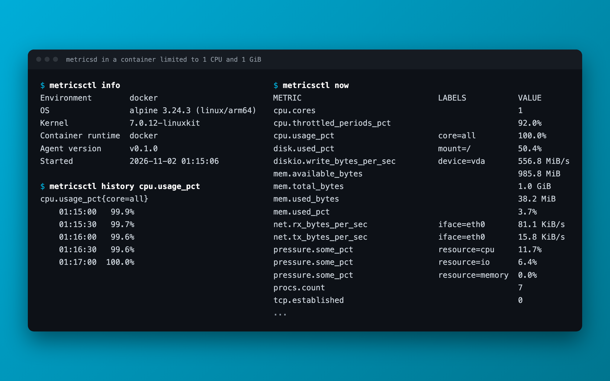

<p align="center">
  
</p>

<h1 align="center">metricsd</h1>

<p align="center">
  <b>Linux metrics agent; static Go binaries that measure the machine or container they run in and export over OTLP.</b>
</p>

<p align="center">
  Collects about 90 metrics from physical machines, VMs, Docker, Podman, and Kubernetes, keeps a rolling history in SQLite, and ships it to a central server.<br>
  <i>By Brian Nunez.</i>
</p>

<p align="center">
  
  
  
  
  <br>
  <a href="https://github.com/brian-nunez/metricsd/releases/latest"></a>
  <a href="https://pkg.go.dev/github.com/brian-nunez/metricsd"></a>
</p>

<p align="center">
  <a href="docs/onboarding.md"></a>
</p>

<p align="center">
  <a href="docs/onboarding.md"><b>Onboarding</b></a> ·
  <a href="https://github.com/brian-nunez/metricsd/releases">Releases</a> ·
  <a href="docs/containers.md">Containers</a> ·
  <a href="docs/export.md">Export</a> ·
  <a href="docs/metrics.md">Metrics</a>
</p>

<br>

<p align="center">
  
  <br><sub><b>Container view</b>: real <code>metricsctl</code> output from a container under load, measured against its own limits. Rows trimmed to fit.</sub>
</p>

> [!WARNING]
> **metricsd is a proof of concept.** Evaluate it before relying on it in production.
>
> It runs on Linux only: metrics come from `/proc` and `/sys`, and container metrics need cgroup v2, the default on current distributions. systemd is optional and only used to run it as a service.

<p align="center">
  <a href="#why-metricsd">Why metricsd</a> ·
  <a href="#what-it-looks-like">What it looks like</a> ·
  <a href="#quick-start">Quick start</a> ·
  <a href="#metrics">Metrics</a> ·
  <a href="#documentation">Documentation</a> ·
  <a href="#project-layout">Project layout</a> ·
  <a href="#license">License</a>
</p>

## Why metricsd

- **Environment-aware.** It detects whether it is on a physical machine, a VM, Docker, Podman, or Kubernetes, and measures that. A container on a VM on a server is three independent sources.
- **Rootless-ready.** It works under rootless Docker and Podman. Missing cgroup controllers mean missing metrics, never fake zeros. See [docs/containers.md](docs/containers.md).
- **Broad.** About 90 metrics cover CPU, memory, swap, disk space and IO, network, TCP/UDP, pressure stall, processes, temperatures, fans, and battery.
- **OTLP native.** It exports over HTTP or gRPC with TLS, mutual TLS, and header auth, and sends identity as standard resource attributes. See [docs/export.md](docs/export.md).
- **Buffered.** The local database is the export buffer, so outages are backfilled with their original timestamps.
- **Private.** The local API is JSON over a `0600` Unix socket, never a network port.
- **Small.** Binaries are static with no CGO, and the `scratch` image is under 30 MB, ready to copy into any container.
- **Hardened.** The systemd user unit runs with a read-only filesystem, restricted sockets, and syscall filtering. See [docs/systemd.md](docs/systemd.md).

## What it looks like

`metricsctl` reads from the local daemon. This is a container limited to one CPU and 1 GiB:

```console
$ metricsctl info
Environment        docker
OS                 alpine 3.24.3 (linux/arm64)
Kernel             7.0.12-linuxkit
Container runtime  docker
Agent version      v0.1.0
...

$ metricsctl now
METRIC                             LABELS           VALUE
cpu.cores                                           1
cpu.throttled_periods_pct                           92.0%
cpu.usage_pct                      core=all         100.0%
mem.total_bytes                                     1.0 GiB
mem.used_bytes                                      38.2 MiB
net.rx_bytes_per_sec               iface=eth0       81.1 KiB/s
pressure.some_pct                  resource=cpu     11.7%
...
```

The same data is available over the local API:

```bash
curl -s --unix-socket "$XDG_RUNTIME_DIR/metricsd/metricsd.sock" http://x/v1/metrics | jq
```

## Quick start

### On a machine (PC, server, VM)

Install with Go 1.27 or newer:

```bash
go install github.com/brian-nunez/metricsd@latest
go install github.com/brian-nunez/metricsd/metricsctl@latest
```

Or download a prebuilt release for `amd64`, `arm64`, or `armv7` without Go:

```bash
ARCH=$(uname -m | sed 's/x86_64/amd64/; s/aarch64/arm64/; s/armv7l/armv7/')
curl -fsSL "https://github.com/brian-nunez/metricsd/releases/latest/download/metricsd_linux_$ARCH.tar.gz" | tar -xz
install -Dm755 -t ~/.local/bin "metricsd_linux_$ARCH/metricsd" "metricsd_linux_$ARCH/metricsctl"
```

Make sure `$(go env GOPATH)/bin` or `~/.local/bin` is on your `PATH`, then start the daemon and read from it:

```bash
metricsd &                     # start the daemon
metricsctl info                # show what it is measuring
metricsctl now                 # show the latest metrics
```

[docs/installation.md](docs/installation.md) shows how to run it as a systemd service, verify checksums, build from source, and upgrade.

### In a container

Build the image, then copy the binaries into your application's image so metricsd runs inside the container it measures:

```bash
docker build -t metricsd .
```

```dockerfile
# your application's Dockerfile
COPY --from=metricsd:latest /usr/local/bin/ /usr/local/bin/
CMD ["sh", "-c", "metricsd & exec myapp"]
```

```bash
docker exec myapp metricsctl now
```

See [docs/containers.md](docs/containers.md).

### Send to a central server

```toml
# ~/.config/metricsd/config.toml
[tags]
env = "prod"

[export.otlp]
enabled  = true
protocol = "grpc"
endpoint = "https://otel.example.com:4317"
```

See [docs/export.md](docs/export.md).

## Metrics

| Group | Examples | Machines | Containers |
| ----- | -------- | :------: | :--------: |
| CPU | usage per core and by mode, cores, frequency, context switches, throttling | ✓ | ✓ (vs. its CPU limit) |
| Memory | used, available, cached, slab, dirty, page faults, OOM kills | ✓ | ✓ (vs. its memory limit) |
| Swap | used, free, in/out rates | ✓ | ✓ |
| Load | 1/5/15 minute averages | ✓ | – |
| Disk | space and inodes per mount | ✓ | ✓ (root and volumes) |
| Disk IO | throughput, IOPS, latency, busy % | ✓ | ✓ (its own IO) |
| Network | bytes, packets, errors, drops per interface | ✓ | ✓ |
| TCP/UDP | connections, retransmits, resets, datagrams, sockets | ✓ | ✓ |
| Pressure | CPU, memory, IO stall % | ✓ | ✓ |
| System | uptime, processes, threads, open files, users | ✓ | ✓ (uptime, processes, task limit) |
| Sensors | temperatures, fan RPM, battery, AC power | ✓ | – |

Full reference: [docs/metrics.md](docs/metrics.md).

## Documentation

| Doc | Covers |
| --- | ------ |
| [Onboarding](docs/onboarding.md) | **Start here**: production config, install and manage on VMs, Docker, Podman, Kubernetes |
| [Installation](docs/installation.md) | Requirements, `make install`, Docker image, manual install |
| [Containers](docs/containers.md) | Docker, Podman, Kubernetes, rootless, adding to images |
| [Export](docs/export.md) | OTLP HTTP/gRPC, TLS, auth, resource attributes, buffering |
| [Usage](docs/usage.md) | Every `metricsctl` command and flag |
| [Configuration](docs/configuration.md) | Every config key, defaults, validation |
| [Metrics](docs/metrics.md) | Metric names, labels, units, sources |
| [API](docs/api.md) | Endpoints, parameters, JSON schemas, errors |
| [systemd](docs/systemd.md) | Running as a service, sandboxing, drop-ins, logs |
| [Architecture](docs/architecture.md) | How it works, storage schema, disk usage sizing |
| [Troubleshooting](docs/troubleshooting.md) | Common errors and fixes |
| [Uninstall](docs/uninstall.md) | Removing binaries, service, and data |
| [Releasing](docs/releasing.md) | Tagging a version and publishing prebuilt binaries |
| [Examples](examples/README.md) | Annotated example configs |

## Project layout

```text
main.go                daemon entry point and collector registry
metricsctl/            CLI client
internal/collector/    collectors: host (gopsutil, /proc, /sys) and container (cgroup v2)
internal/environment/  physical / VM / Docker / Podman / Kubernetes detection
internal/identity/     who is being measured: IDs, OS, container and pod details
internal/export/       exporter interface and buffered delivery loop
internal/export/otlp/  OTLP HTTP and gRPC exporter
internal/store/        SQLite storage, retention, export cursors
internal/api/          HTTP handlers and Unix socket listener
internal/config/       TOML config, defaults, validation
internal/wire/         JSON types and units shared by daemon and client
internal/version/      build version
deploy/                systemd unit and reference config
examples/              example configs with explanations
docs/                  user documentation
Dockerfile             minimal image for copying into application images
.github/workflows/     release workflow that publishes prebuilt binaries
```

## License

metricsd is licensed under the [MIT License](LICENSE). Copyright (c) 2026 Brian Nunez.
